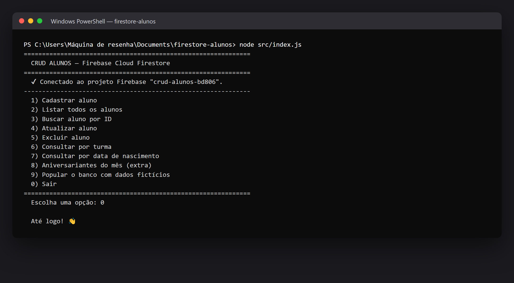
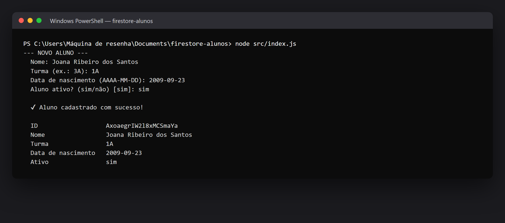
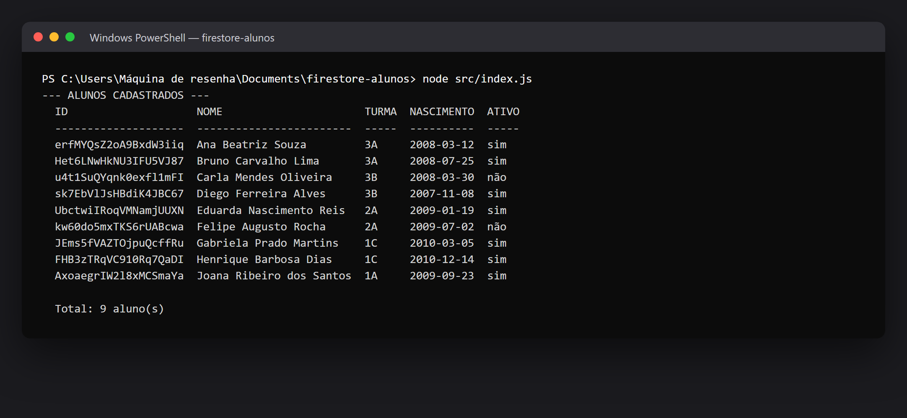
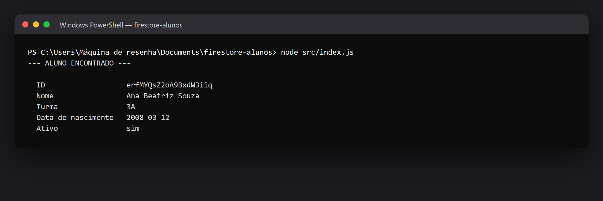
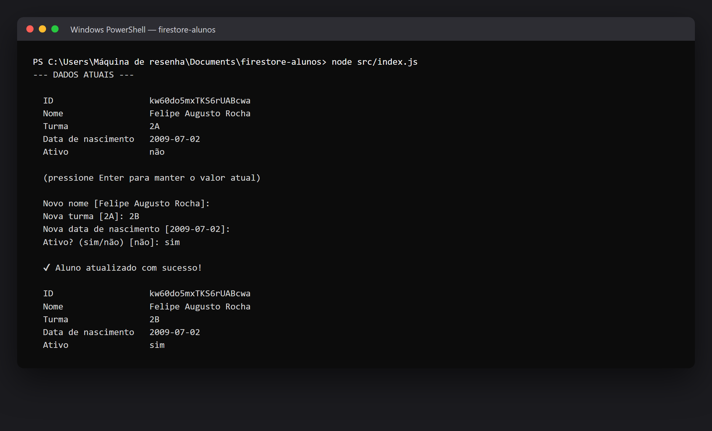
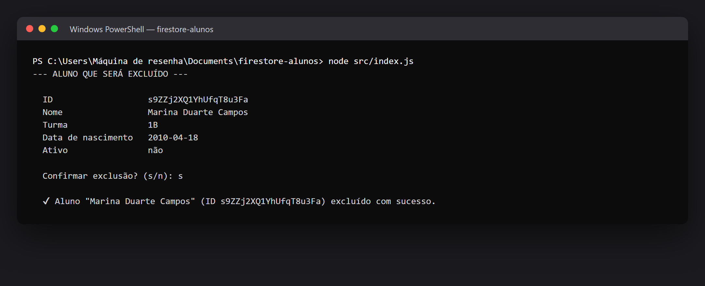
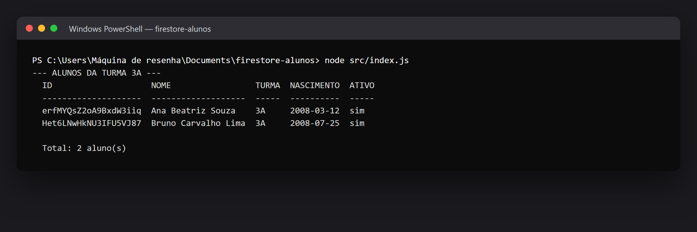
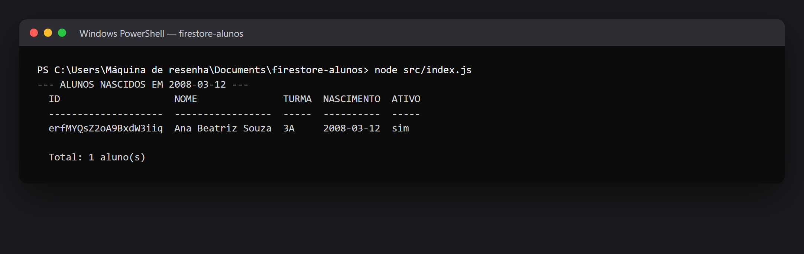

# CRUD Alunos — Firebase Cloud Firestore

Aplicação em **Node.js** que manipula a coleção `alunos` no **Firebase Cloud Firestore** usando o
**Firebase Admin SDK**, com menu interativo no terminal.

Atividade prática: CREATE, READ, UPDATE, DELETE + consultas por turma e por data de nascimento.

---

## Sumário

1. [Estrutura da coleção](#estrutura-da-coleção)
2. [Requisitos](#requisitos)
3. [Passo 1 — Criar o projeto no Firebase](#passo-1--criar-o-projeto-no-firebase)
4. [Passo 2 — Baixar a chave da conta de serviço](#passo-2--baixar-a-chave-da-conta-de-serviço)
5. [Passo 3 — Instalar e rodar](#passo-3--instalar-e-rodar)
6. [Menu do terminal](#menu-do-terminal)
7. [Operações implementadas](#operações-implementadas)
8. [Como o código está organizado](#como-o-código-está-organizado)
9. [Dados fictícios](#dados-fictícios)
10. [Rodar sem Firebase (emulador)](#rodar-sem-firebase-emulador)
11. [Publicar no GitHub com segurança](#publicar-no-github-com-segurança)
12. [Roteiro das capturas de tela](#roteiro-das-capturas-de-tela)
13. [Problemas comuns](#problemas-comuns)
14. [Checklist da entrega](#checklist-da-entrega)

---

## Estrutura da coleção

Coleção: **`alunos`** — um documento por aluno (o ID é gerado automaticamente pelo Firestore).

| Campo            | Tipo    | Regra                                        |
| ---------------- | ------- | -------------------------------------------- |
| `nome`           | string  | obrigatório, 3 a 120 caracteres              |
| `turma`          | string  | obrigatório, salvo em maiúsculas (ex.: `3A`) |
| `dataNascimento` | string  | `AAAA-MM-DD`, data real e não futura         |
| `ativo`          | boolean | `true` / `false`                             |

Campos extras gravados automaticamente: `criadoEm` e `atualizadoEm` (timestamp do servidor).

---

## Requisitos

- Node.js 18 ou superior (`node -v`)
- Uma conta Google
- Conta no GitHub (para a entrega)

---

## Passo 1 — Criar o projeto no Firebase

1. Acesse <https://console.firebase.google.com> e clique em **Adicionar projeto**.
2. Dê um nome (ex.: `crud-alunos`) e finalize a criação (o Google Analytics é opcional).
3. No menu lateral, clique em **Criação > Firestore Database** → **Criar banco de dados**.
4. Escolha o local (ex.: `southamerica-east1`) e o modo **Teste** para a atividade.
   - O modo de teste libera acesso por 30 dias — suficiente para a entrega.
   - O Admin SDK **ignora as regras de segurança**, então o CRUD funciona de qualquer forma.
5. Pronto: o banco existe. Você **não precisa** criar a coleção `alunos` na mão —
   ela é criada no primeiro cadastro.

---

## Passo 2 — Baixar a chave da conta de serviço

1. No console do Firebase: ⚙️ **Configurações do projeto** → aba **Contas de serviço**.
2. Clique em **Gerar nova chave privada** → **Gerar chave**.
3. Um arquivo `.json` será baixado. **Renomeie para `serviceAccountKey.json`**
   e coloque na raiz deste projeto (ao lado do `package.json`).

```
firestore-alunos/
├── serviceAccountKey.json   ← você adiciona (NÃO vai para o GitHub)
├── package.json
└── src/
```

> ⚠️ Esse arquivo dá acesso total ao seu projeto Firebase. Ele já está listado no
> `.gitignore`; nunca remova essa linha e nunca cole o conteúdo dele em lugar público.

Alternativas (opcionais):

```bash
# 1) Apontar para outro caminho
GOOGLE_APPLICATION_CREDENTIALS=C:\caminho\chave.json

# 2) JSON inteiro em uma variável de ambiente
FIREBASE_SERVICE_ACCOUNT_JSON={"type":"service_account",...}
```

---

## Passo 3 — Instalar e rodar

```bash
npm install
npm start
```

> 💡 **No seu Windows (PowerShell)** o comando `npm` é bloqueado pela política de execução
> de scripts. Use a versão `.cmd`, que funciona normalmente:
>
> ```powershell
> npm.cmd install
> npm.cmd start
> ```
>
> Se preferir liberar de vez: `Set-ExecutionPolicy -Scope CurrentUser RemoteSigned`
> (abra um PowerShell novo depois). No Prompt de Comando (cmd) `npm` funciona direto.

Se tudo estiver certo, o menu abre mostrando:

```
  ✔ Conectado ao projeto Firebase "crud-alunos".
```

Para inserir 8 alunos fictícios de uma vez:

```bash
npm run seed
```

---

## Menu do terminal

```
==============================================================
  CRUD ALUNOS — Firebase Cloud Firestore
==============================================================
  ✔ Conectado ao projeto Firebase "crud-alunos".
--------------------------------------------------------------
  1) Cadastrar aluno
  2) Listar todos os alunos
  3) Buscar aluno por ID
  4) Atualizar aluno
  5) Excluir aluno
  6) Consultar por turma
  7) Consultar por data de nascimento
  8) Aniversariantes do mês (extra)
  9) Popular o banco com dados fictícios
  0) Sair
==============================================================
  Escolha uma opção:
```

---

## Operações implementadas

| Requisito | Opção do menu | Função no código |
| --------- | ------------- | ---------------- |
| **CREATE** — cadastrar aluno | `1` | `cadastrarAluno()` |
| **READ** — listar alunos | `2` | `listarAlunos()` |
| **READ** — buscar por ID | `3` | `buscarAlunoPorId()` |
| **UPDATE** — atualizar aluno | `4` | `atualizarAluno()` |
| **DELETE** — excluir aluno | `5` | `excluirAluno()` |
| Consulta por **turma** | `6` | `listarAlunosPorTurma()` |
| Consulta por **data de nascimento** | `7` | `listarAlunosPorDataNascimento()` |
| Consulta extra (aniversariantes) | `8` | `listarAniversariantesDoMes()` |
| Popular com dados fictícios | `9` | `popularComDadosFicticios()` |

Detalhes importantes:

- **CREATE** valida todos os campos antes de gravar e usa `collection().add()`, que gera o ID automático.
- **UPDATE** é **parcial**: pressione Enter para manter o valor atual de um campo.
  Só os campos realmente alterados são enviados ao Firestore (`doc().update()`).
- **DELETE** mostra o aluno e pede confirmação (`s/n`) antes de apagar.
- **Consultas** usam `where('turma', '==', ...)` e `where('dataNascimento', '==', ...)`.
  A ordenação por nome é feita em memória para **não exigir índice composto** no Firestore.
- Todos os erros (data inválida, ID inexistente, credencial ausente) aparecem como
  mensagem amigável, sem derrubar o programa.

---

## Como o código está organizado

```
firestore-alunos/
├── package.json
├── .gitignore              # protege o serviceAccountKey.json
├── .env.example            # exemplo de variáveis de ambiente
├── README.md
└── src/
    ├── index.js                         # ponto de entrada: verifica config e abre o menu
    ├── config/
    │   └── firebase.js                  # inicializa o Admin SDK e entrega o Firestore
    ├── services/
    │   ├── alunosService.js             # TODO o CRUD e as consultas
    │   └── seedService.js               # inserção em lote dos dados fictícios
    ├── ui/
    │   ├── menu.js                      # menu, perguntas e fluxo das ações
    │   └── tabela.js                    # impressão em tabela no terminal
    ├── utils/
    │   └── validacao.js                 # regras de nome, turma, data e ativo
    ├── data/
    │   └── alunosFicticios.js           # os 8 alunos de demonstração
    └── scripts/
        └── seed.js                      # CLI do `npm run seed`
```

Separação de responsabilidades: o menu **não** fala com o Firestore diretamente,
ele chama o `alunosService`. Assim a regra de negócio fica em um só lugar
(seria fácil, por exemplo, trocar o terminal por uma API REST depois).

Explicação didática de cada conceito (Admin SDK, documentos, collections, queries…):
veja [`docs/EXPLICACAO.md`](docs/EXPLICACAO.md).

---

## Dados fictícios

`src/data/alunosFicticios.js` contém 8 alunos inventados, com turmas variadas
(`3A`, `3B`, `2A`, `1C`), datas de nascimento em meses diferentes e alguns inativos.
Nenhum dado real de aluno é usado.

---

## Rodar sem Firebase (emulador)

Opcional, útil para testar o código antes de configurar o projeto real.
Precisa do Java instalado.

```bash
# terminal 1
npx firebase-tools emulators:start --only firestore --project demo-alunos

# terminal 2
FIRESTORE_EMULATOR_HOST=127.0.0.1:8080 npm start
```

No PowerShell:

```powershell
$env:FIRESTORE_EMULATOR_HOST="127.0.0.1:8080"
npm start
```

---

## Publicar no GitHub com segurança

```bash
git init
git add .
git status          # confirme que serviceAccountKey.json NÃO aparece na lista
git commit -m "feat: CRUD de alunos com Firestore"
git branch -M main
git remote add origin https://github.com/SEU-USUARIO/firestore-alunos.git
git push -u origin main
```

Antes de enviar, confira:

- [ ] `serviceAccountKey.json` **não** aparece em `git status` nem no repositório.
- [ ] `node_modules/` **não** foi commitado (está no `.gitignore`).
- [ ] O `README.md` explica como rodar o projeto.

Se a chave já foi enviada por engano:

1. Gere uma **nova chave** no console do Firebase e apague a antiga.
2. Remova do Git: `git rm --cached serviceAccountKey.json` e faça commit.
3. Se o repositório for público, considere recriá-lo (o histórico guarda o arquivo).

---

## Roteiro das capturas de tela

A atividade pede prints do CRUD e das consultas. Sugestão de 8 capturas
(terminal com a tabela/resultado visível e, se quiser, o console do Firebase ao lado):

1. **Menu principal** com a mensagem `✔ Conectado ao projeto Firebase "..."`.
2. **CREATE** — opção 1 preenchida + mensagem `✔ Aluno cadastrado com sucesso!`.
3. **READ** — opção 2 com a tabela de alunos (`npm run seed` antes ajuda a ter dados).
4. **READ por ID** — opção 3 com os dados de um aluno.
5. **UPDATE** — opção 4 mostrando os dados antigos, os novos valores e o resultado.
6. **DELETE** — opção 5 com a confirmação e a mensagem de exclusão.
7. **Consulta por turma** — opção 6 (ex.: `3A`) filtrando corretamente.
8. **Consulta por data de nascimento** — opção 7 (ex.: `2008-03-12`).

Dica: no console do Firebase, a aba **Firestore Database > Dados** mostra a coleção
`alunos` e serve como print extra comprovando que os dados estão no banco.

### Prints já gerados (execuções reais neste projeto)

Essas imagens foram geradas a partir de execuções reais do programa contra o Firestore
do projeto (8 alunos fictícios na coleção `alunos`):

| | |
| --- | --- |
|  |  |
|  |  |
|  |  |
|  |  |

Se quiser substituir por capturas da sua própria tela, é só rodar `npm start`
e apertar `Print Screen` / `Win + Shift + S` em cada passo.

---

## Problemas comuns

| Mensagem / sintoma | Causa e solução |
| ------------------ | --------------- |
| `Arquivo de credenciais não encontrado` | O `serviceAccountKey.json` não está na raiz do projeto ou o nome está diferente. |
| `O arquivo ... não é um JSON válido` | Download incompleto/corrompido. Gere a chave novamente. |
| `PERMISSION_DENIED` | Firestore não foi criado no console, ou a chave é de outro projeto. |
| `5 NOT_FOUND` | O banco Firestore ainda não existe no projeto — crie em **Firestore Database**. |
| `não pode ser carregado porque a execução de scripts foi desabilitada` (PowerShell) | Use `npm.cmd install` / `npm.cmd start`, ou rode no Prompt de Comando. |
| Acentos estranhos no terminal | Use o Windows Terminal ou `chcp 65001`. |
| `Error: Cannot find module 'firebase-admin'` | Falta `npm install`. |

---

## Checklist da entrega

- [ ] Projeto criado no Firebase com o Firestore habilitado.
- [ ] `serviceAccountKey.json` fora do repositório.
- [ ] CRUD funcionando pelas opções 1 a 5 do menu.
- [ ] Consultas por turma e por data de nascimento funcionando.
- [ ] Prints das 8 capturas acima.
- [ ] Link do repositório e prints enviados no Google Sala de Aula.
